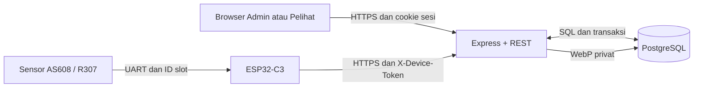

# Arsitektur ELITE



Next.js menyajikan landing page dan meneruskan /api ke Express. PostgreSQL menyimpan akun, jadwal, absensi, serta foto WebP privat. Demo menggunakan PGlite dalam memori.

Anggota mendaftarkan username dan kata sandi. Setelah admin mengaktifkan akun, login membuka sesi dengan cookie HttpOnly dan token yang disimpan sebagai hash. Pencabutan akses menutup sesi.

Sensor mencocokkan template secara lokal. Perangkat mengirim ID slot dan UUID transaksi ke server. Heartbeat mengatur status online dengan ambang 90 detik. Server membuat satu catatan per anggota dan tanggal WIB, lalu mengisi jam pulang pada scan berikutnya. Scan baru dalam 90 detik setelah scan yang diterima dianggap ganda. UUID yang sama mengembalikan hasil sebelumnya. Setelah pulang tercatat, scan selanjutnya menjaga catatan yang ada. Admin dapat koreksi melalui input manual. Browser menyegarkan daftar presensi hari ini dan ringkasan dashboard setiap 12 detik. Halaman operasional menampilkan tren 7 atau 14 hari. Riwayat admin dicatat dalam transaksi yang sama dengan perubahan absensi manual, verifikasi laporan, tautan fingerprint, atau akses username. Riwayat tersedia khusus Admin.

Laporan memakai satu tabel dengan jenis `piket` atau `dokumentasi`. Piket menyimpan snapshot petugas saat laporan dibuat. Verifikasi piket membaca kehadiran piket pada tanggal laporan. Dokumentasi memakai absensi anggota dari jurusan terkait. Catatan wajib saat keputusan **Perlu Revisi**. Tabel menyimpan pengunggah, pemeriksa, dan waktu pemeriksaan.

## Kontrak REST

Semua rute berikut berawalan `/api`. POST/PUT/PATCH/DELETE browser menggunakan origin yang sama dan sesi sesuai peran.

| Metode dan path | Akses dan input |
|---|---|
| `GET /session` | Publik. Mengembalikan pengguna aktif atau null dan status demo |
| `POST /auth/signup`, `POST /auth/signin` | Daftar dengan nama, username, kelas, jurusan dan kata sandi. Masuk menggunakan username dan kata sandi |
| `POST /auth/reset` | Pemulihan menggunakan username, kode sekali pakai dan kata sandi baru. Sesi lama dicabut. |
| `POST /auth/logout` | Mengakhiri sesi browser |
| `GET /overview` | Pengguna aktif. Ringkasan hari ini, perangkat, petugas, laporan |
| `GET /insights` | Pengguna aktif. Empat belas hari rekap dalam WIB dan sampai enam aktivitas dari tujuh hari terakhir |
| `GET /admin/audit` | Admin. Maksimum 30 tindakan terbaru dengan akun pelaku, detail, dan waktu |
| `GET /attendance?date=YYYY-MM-DD` | Pengguna aktif. Tanggal opsional, default hari ini. `roster=true` menyertakan semua anggota aktif pada hari ini dengan status `unmarked` bila belum ada presensi |
| `PUT /attendance` | Admin. `member_id,date,status,check_in_time,check_out_time,notes`. Jam HH:mm atau null. Status present, absent, excused, competition. Status selain present mengharuskan kedua jam bernilai null |
| `GET /picket?day=1` | Pengguna aktif. Senin = 1 hingga Jumat = 5 |
| `GET /picket-attendance?date=YYYY-MM-DD` | Pengguna aktif. Mengembalikan petugas beserta status, waktu pencatatan, dan semua laporan pada tanggal kerja itu |
| `POST /picket-reports` | Pelihat atau Admin. Multipart berisi `date`, `present_ids` (ID anggota terjadwal dipisahkan koma), serta foto `before`, `after`, `group`. Identitas pengunggah berasal dari sesi |
| `PATCH /admin/members/:id`, `DELETE /admin/members/:id` | Ubah profil dan kredensial atau nonaktifkan anggota beserta akses, pertahankan riwayat |
| `POST /picket`, `DELETE /picket/:id` | Admin. Jadwalkan `{day,member_id}` atau hapus jadwal |
| `GET /reports?kind=piket&before=25` | Pengguna aktif. `kind` dan kursor `before` opsional. Maksimum 24 laporan, urut ID terbaru. `pending=true` khusus admin |
| `GET /reports/:id/photo` | Pengguna aktif. Mengembalikan WebP. Parameter `view=before|after|group` memilih bukti piket |
| `POST /reports` | Admin. Multipart `kind,date,caption,photo`, serta `division` wajib untuk dokumentasi. Foto upload max 5 MB |
| `GET /admin/reports/:id/context` | Admin. Foto, absensi pembanding dan petugas |
| `PATCH /admin/reports/:id` | Admin. JSON `{status,note}`, status approved atau rejected |
| `GET /admin/members`, `POST /admin/members` | Admin. Buat profil dengan `full_name,username,password,class_name,division`. Kolom `division` menyimpan jurusan sekolah |
| `PATCH /admin/members/:id/fingerprint` | Admin. `{fingerprint_id}` dengan nomor slot atau null |
| `GET /admin/users`, `POST /admin/users` | Admin. Aktifkan akun dan peran melalui `{username,role}` |
| `DELETE /admin/users/:id` | Admin. Cabut akun beserta sesi |
| `POST /iot/heartbeat` | Perangkat. JSON `{device_id}` dan header X-Device-Token |
| `POST /iot/fingerprint-attendance` | Perangkat. Payload di bawah dan header X-Device-Token |

```json
{
  "device_id": "ESP32-C3-LAB-01",
  "fingerprint_id": 12,
  "event_id": "935d4ddc-fc18-479d-8da3-28300d488b61"
}
```

Contoh respons HTTP 200: `{"status":"success","name":"Budi","type":"IN"}`. Nilai `type` bisa IN, OUT, DUPLICATE, atau UNCHANGED. Slot tidak terhubung menghasilkan 404. Token invalid menghasilkan 401. Ulangi scan yang sama dengan UUID semula jika respons belum diterima. UUID baru dipakai untuk pemindaian baru.

## Ukuran dan kompatibilitas

Gambar galeri dimuat secara lazy. Foto unggahan diubah ukurannya menjadi maksimum 1600 piksel pada sisi terpanjang dan dikonversi WebP di server. Browser lebih dahulu mengompresi format yang dapat didekode secara lokal. Untuk HEIC mentah, dukungan dekode server bergantung pada build libvips. Ekspor sebagai JPEG bila server menolak HEIC. UI menyediakan preferensi reduced motion dan tata letak untuk layar sempit. Uji produksi dengan akun anggota, Postgres eksternal dan unit fisik diperlukan sebelum memakai data sekolah nyata.

## Relasi data dan migrasi akun

| Tabel | Identitas dan hubungan |
|---|---|
| users, sessions | Username unik, hash scrypt dan salt, peran, status aktif. Sesi menyimpan hash token dan batas 48 jam. |
| members | ID anggota, akun unik melalui user_id, nama, kelas, jurusan. Pasangan perangkat dan nomor slot unik. Profil lama tanpa akun dapat diberi username dan sandi melalui Edit anggota. |
| devices, scan_events | Perangkat menyimpan waktu heartbeat. Pasangan device_id dan event_id unik menyimpan hasil transaksi untuk retry. |
| attendances | Satu baris per anggota dan tanggal Sabtu. Waktu masuk/pulang, status, sumber pencatatan awal, perangkat untuk scan baru, dan catatan koreksi. |
| picket_schedules | Satu anggota per hari kerja dalam jadwal mingguan. |
| picket_attendance | Satu anggota per tanggal piket. Menyimpan salinan nama, kelas, jurusan, status, waktu, dan tautan ke laporan. |
| reports, admin_changes | Foto sebelum/sesudah/bersama beserta pencatat dan pemeriksa. Log tindakan admin mencatat pelaku dan waktu. |

Saat pertama dijalankan di database lama, migrasi mempertahankan ID akun dan hash sandi. Username berasal dari bagian sebelum @. Nama yang bentrok, terlalu pendek, atau mengandung karakter di luar format mendapat username anggota-ID. Panel Admin menampilkan hasilnya. Profil lama dan akun lama tidak dicocokkan berdasarkan nama siswa. Laporan lama tetap tersedia pada tanggal aslinya dan tidak menghasilkan kehadiran piket rekaan.

REST HTTPS memanfaatkan endpoint Vercel yang sudah dipakai. Perangkat hanya perlu melakukan permintaan keluar, dan retry memakai event_id yang sama. Polling 12 detik memperbarui dashboard dan absensi Sabtu selama halaman terbuka. Kegagalan kirim yang belum mencapai server hanya dapat dilihat di Serial Monitor. Dashboard menampilkan heartbeat dan hasil pengiriman yang telah diterima.

## Pemeriksaan setelah pemasangan

1. Atur environment pada README dan deploy. Masuk sebagai admin. Tambah anggota dengan username unik, kelas, jurusan dan sandi minimal delapan karakter.
2. Daftarkan jari pada sensor melalui Serial Monitor, lalu tautkan nomor slot di Panel Admin. Percobaan memasangkan slot yang sama ke anggota lain menghasilkan konflik.
3. Pada Sabtu WIB, pindai sekali dan periksa sumber Fingerprint serta jam masuk. Ulangi pengiriman dengan UUID semula untuk memeriksa idempotensi. Scan berbeda dalam 90 detik menghasilkan DUPLICATE. Koreksi manual mempertahankan sumber awal.
4. Putus Wi-Fi sebentar ketika ada scan tertunda, lalu sambungkan kembali dalam 30 detik. Periksa hanya satu transaksi diterima. Setelah 30 detik, pindai ulang. Putus lebih dari 90 detik untuk melihat status offline. Verifikasi perilaku ini pada papan fisik.
5. Untuk piket, jadwalkan petugas lalu buka Absensi Piket pada hari kerja. Pilih nama yang hadir dan unggah tiga foto. Periksa rekap, pengunggah, dan jam WIB. Buka tanggal lain serta Absensi Anggota untuk memastikan catatan tetap terpisah.

## Pengembangan lanjutan

Setelah data satu bulan tersedia, prioritaskan rekap bulanan per kelas dan jurusan dengan ekspor CSV untuk pembina. Gunakan sumber yang sama dengan riwayat harian agar angka rekap dapat ditelusuri.
