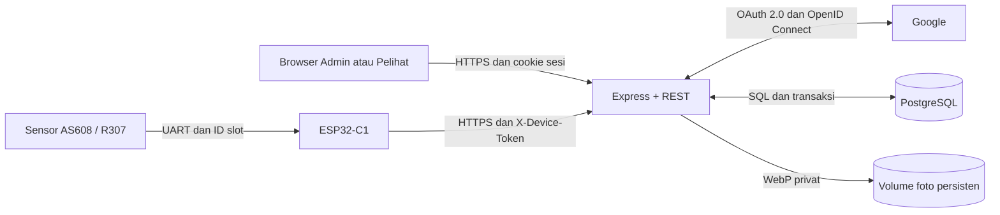

# Arsitektur ELITE



Vite membangun frontend Vanilla JS dan Tailwind CSS. Pada produksi, Express menyajikan UI dan API dari origin yang sama. Data memakai PostgreSQL agar profil, jadwal, dan absensi dapat divalidasi melalui relasi serta constraint unik. Demo memakai PGlite dalam memori dan menjalankan skema SQL yang sama. Foto disimpan di luar aset publik, di subfolder `piket/` atau `dokumentasi/`, dan melalui pemeriksaan sesi pada setiap permintaan foto. Untuk beberapa instance aplikasi, gunakan penyimpanan objek privat dengan autentikasi API atau signed URL berumur pendek sebagai pengganti disk lokal.

Login Google memakai state satu kali, PKCE, nonce, ID token terverifikasi, dan whitelist Gmail. Sesi disimpan di basis data sebagai hash token dan cookie HttpOnly. Setiap permintaan memeriksa akun aktif dan peran terkini. Pencabutan akses menghapus sesi akun terkait. Tombol Mode Demo dan login tanpa Google hanya tersedia pada mode demo.

Sensor mencocokkan template secara lokal. Perangkat mengirim ID slot dan UUID transaksi ke server. Heartbeat mengatur status online dengan ambang 90 detik. Server membuat satu catatan per anggota dan tanggal WIB, lalu mengisi jam pulang pada scan berikutnya. Scan baru dalam 90 detik setelah scan yang diterima dianggap ganda. UUID yang sama mengembalikan hasil sebelumnya. Setelah pulang tercatat, scan selanjutnya menjaga catatan yang ada. Admin dapat koreksi melalui input manual. Browser menyegarkan status perangkat, presensi hari ini, dan aktivitas operasional setiap 12 detik. Halaman operasional menampilkan tren 7 atau 14 hari. Riwayat admin dicatat dalam transaksi yang sama dengan perubahan absensi manual, verifikasi laporan, tautan fingerprint, atau akses Gmail. Riwayat tersedia khusus Admin.

Laporan memakai satu tabel dengan jenis `piket` atau `dokumentasi`. Piket menyimpan snapshot petugas saat laporan dibuat. Absensi pembanding mengikuti data tanggal laporan, dan dokumentasi membandingkan anggota dari divisi laporan. Catatan wajib saat keputusan **Perlu Revisi**. Tabel menyimpan pengunggah, pemeriksa, dan waktu pemeriksaan.

## Kontrak REST

Semua rute berikut berawalan `/api`. POST/PUT/PATCH/DELETE browser menggunakan origin yang sama dan sesi sesuai peran.

| Metode dan path | Akses dan input |
|---|---|
| `GET /session` | Publik. Mengembalikan pengguna aktif atau null dan status demo |
| `GET /auth/google`, `GET /auth/google/callback` | Publik. Alur OAuth produksi |
| `POST /auth/demo` | Lokal demo. JSON `role` |
| `POST /auth/logout` | Mengakhiri sesi browser |
| `GET /overview` | Pengguna aktif. Ringkasan hari ini, perangkat, petugas, laporan |
| `GET /insights` | Pengguna aktif. Empat belas hari rekap dalam WIB dan sampai enam aktivitas dari tujuh hari terakhir |
| `GET /admin/audit` | Admin. Maksimum 30 tindakan terbaru dengan akun pelaku, detail, dan waktu |
| `GET /attendance?date=YYYY-MM-DD` | Pengguna aktif. Tanggal opsional, default hari ini |
| `PUT /attendance` | Admin. `member_id,date,status,check_in_time,check_out_time,notes`. Jam HH:mm atau null. Status present, excused, competition |
| `GET /picket?day=1` | Pengguna aktif. Senin = 1, Sabtu = 6 |
| `POST /picket`, `DELETE /picket/:id` | Admin. Jadwalkan `{day,member_id}` atau hapus jadwal |
| `GET /reports?kind=piket&before=25` | Pengguna aktif. `kind` dan kursor `before` opsional. Maksimum 24 laporan, urut ID terbaru. `pending=true` khusus admin |
| `GET /reports/:id/photo` | Pengguna aktif. Mengembalikan WebP |
| `POST /reports` | Admin. Multipart `kind,date,caption,photo`, serta `division` wajib untuk dokumentasi. Foto upload max 5 MB |
| `GET /admin/reports/:id/context` | Admin. Foto, absensi pembanding dan petugas |
| `PATCH /admin/reports/:id` | Admin. JSON `{status,note}`, status approved atau rejected |
| `GET /admin/members`, `POST /admin/members` | Admin. Buat profil dengan `full_name,class_name,division` |
| `PATCH /admin/members/:id/fingerprint` | Admin. `{fingerprint_id}` dengan nomor slot atau null |
| `GET /admin/users`, `POST /admin/users` | Admin. Aktifkan alamat Gmail dan peran melalui `{email,role}` |
| `DELETE /admin/users/:id` | Admin. Cabut akun beserta sesi |
| `POST /iot/heartbeat` | Perangkat. JSON `{device_id}` dan header X-Device-Token |
| `POST /iot/fingerprint-attendance` | Perangkat. Payload di bawah dan header X-Device-Token |

```json
{
  "device_id": "ESP32-C1-LAB-01",
  "fingerprint_id": 12,
  "event_id": "935d4ddc-fc18-479d-8da3-28300d488b61"
}
```

Contoh respons HTTP 200: `{"status":"success","name":"Budi","type":"IN"}`. Nilai `type` bisa IN, OUT, DUPLICATE, atau UNCHANGED. Slot tidak terhubung menghasilkan 404. Token invalid menghasilkan 401. Ulangi scan yang sama dengan UUID semula jika respons belum diterima. UUID baru dipakai untuk pemindaian baru.

## Ukuran dan kompatibilitas

Gambar galeri dimuat secara lazy. Foto unggahan diubah ukurannya menjadi maksimum 1600 piksel pada sisi terpanjang dan dikonversi WebP di server. Browser lebih dahulu mengompresi format yang dapat didekode secara lokal. Untuk HEIC mentah, dukungan dekode server bergantung pada build libvips. Ekspor sebagai JPEG bila server menolak HEIC. UI menyediakan preferensi reduced motion dan tata letak untuk layar sempit. Uji produksi dengan kredensial OAuth, Postgres eksternal dan unit fisik diperlukan sebelum memakai data sekolah nyata.
